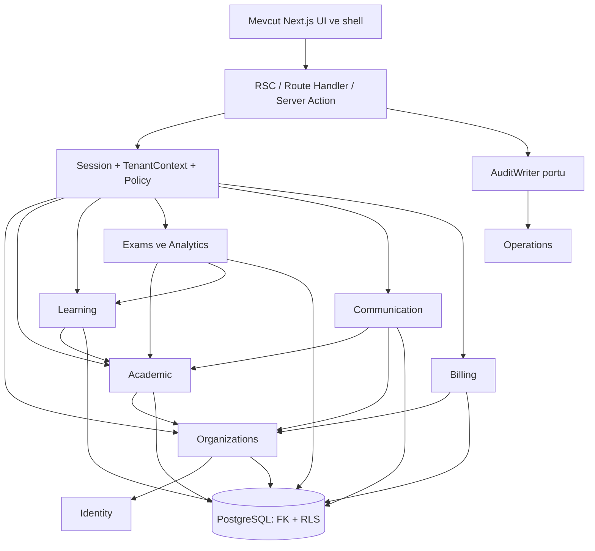
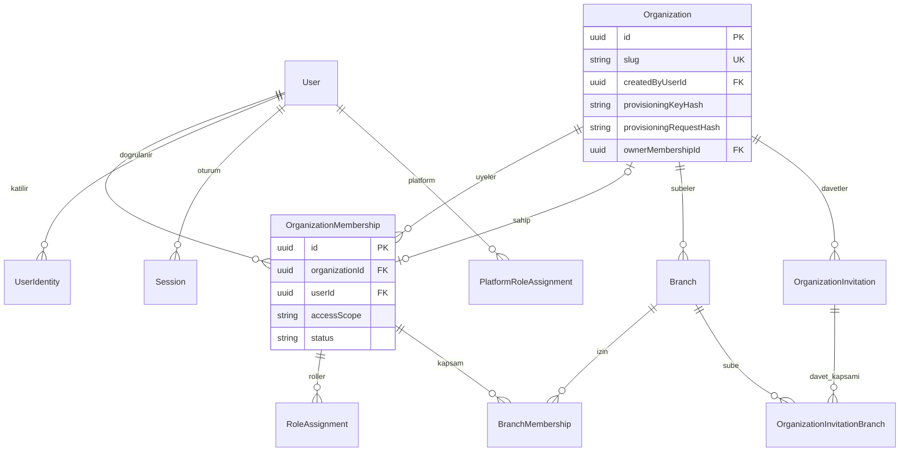
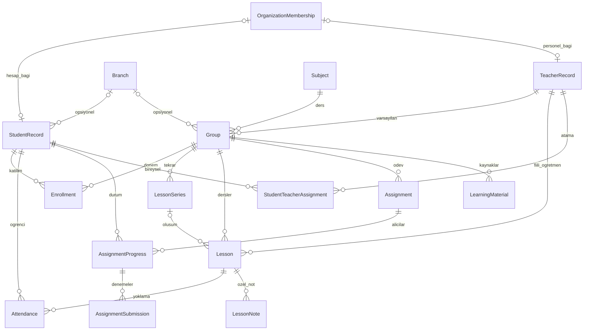
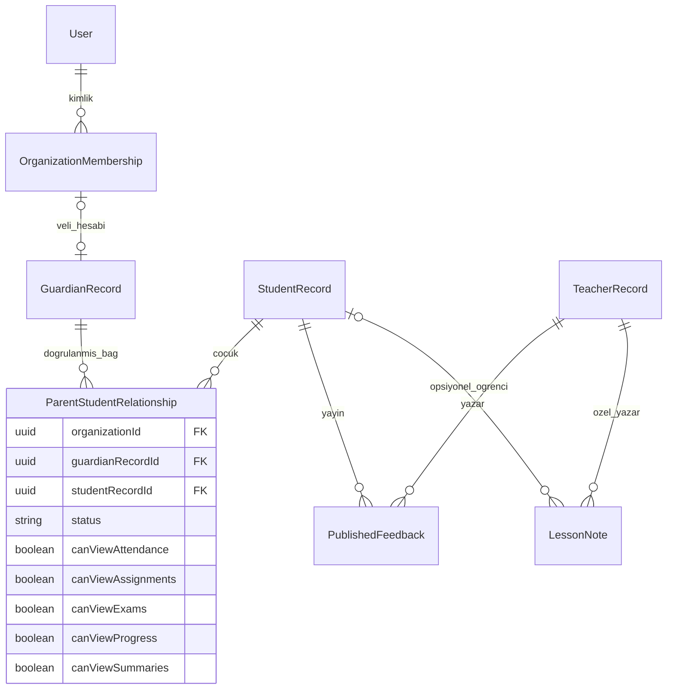
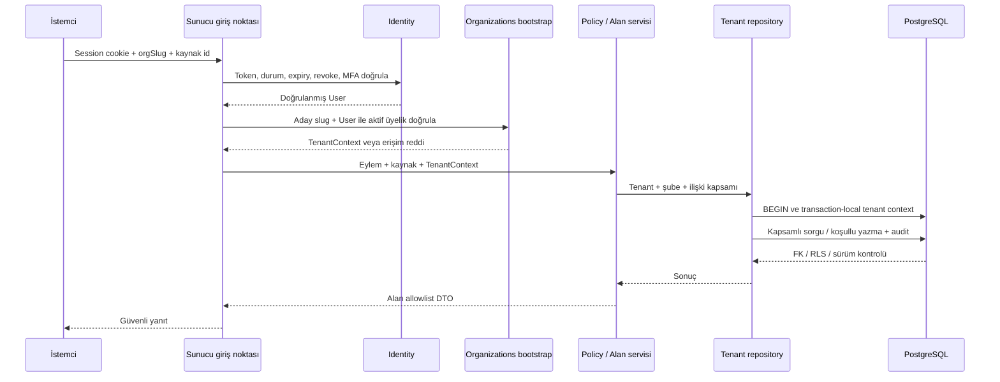
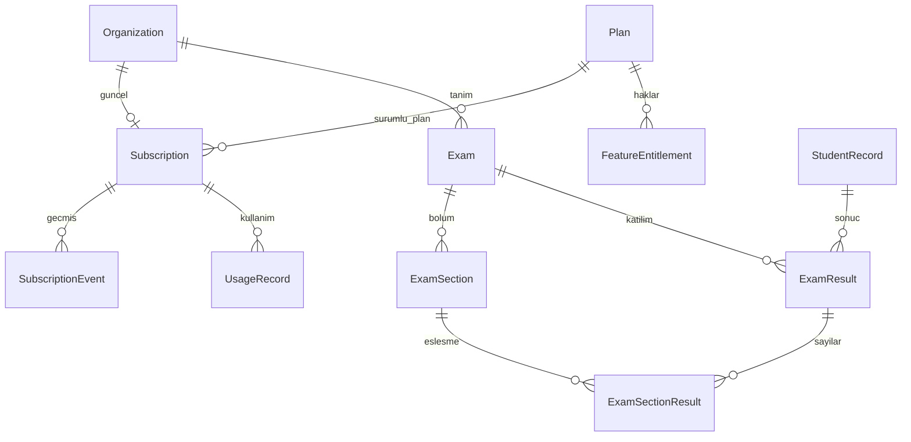
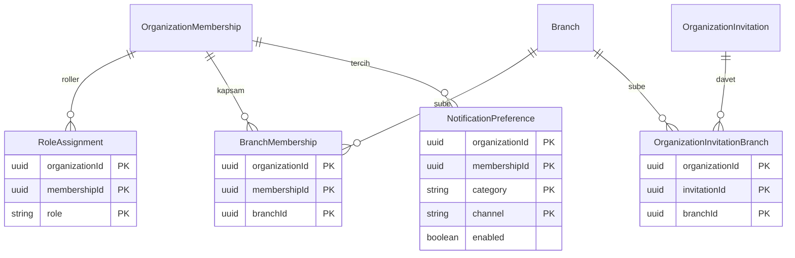

# Mimari ve ilişki diyagramları

İlişkiler [database-design.md](database-design.md) ile eşleşir. ERD'ler okunabilirlik için tüm sütunları göstermez. Tenant bağlantıları organizationId içeren bileşik FK'dır; User/Plan global hedefleri istisnadır. Çizimdeki `org` kısaltması fiziksel organizationId'dir.

## 1. Modüler mimari



## 2. Kurum ve kimlik



Sahip çizgisi nullable DRAFT kurum içindir; ACTIVE kurumda tam bir aktif sahip zorunludur. Membership'in en fazla bir kurumun sahibi olabilmesi aynı-tenant FK ile sağlanır; farklı kuruma ait sahip olamaz.

## 3. Akademik alan



## 4. Veli ve öğrenci mahremiyet sınırı



Veliye giden okuma yayımlanmış DTO + kategori izni üzerinden yapılır. LessonNote'a veli ilişkisi çizilmemesi bilinçli gizlilik kararıdır.

## 5. Tenant farkında istek



## 6. Abonelik ve sınav uzantıları



Subscription bir kuruma tek güncel satırdır; geçmiş event'lerle tutulur. Sınav/abonelik tabloları Faz 02 migration kapsamına girmez.

## 7. İlk kurumun kurulumu (normal tenant resolver'dan ayrı)

```mermaid
sequenceDiagram
  participant U as Faz 05 kurulum istemcisi
  participant A as Faz 03 auth adapter
  participant S as createOrganizationWithOwner
  participant P as Dar provisioning DB fonksiyonu
  participant D as PostgreSQL + role scoped RLS
  participant R as Normal tenant resolver
  U->>A: Oturum + doğrulanmış email + güncel MFA
  A-->>S: VerifiedPrincipal (TenantContext yok)
  S->>P: Normalize input + actor + idempotency key
  P->>D: BEGIN SERIALIZABLE / actor lock / replay kontrolü
  alt Aynı actor-key-digest kaydı yok
    P->>D: Yeni DRAFT + ACTIVE owner Membership
    P->>D: ownerMembershipId ata / Organization ACTIVE
    P->>D: Audit + deferred owner constraint
  else Geçerli tekrar
    P->>D: Yalnız önceki işlem ve actor üyeliğini oku
  end
  D-->>S: COMMIT başarılı, dar sonuç
  Note over P,D: Her adımda hata = tam ROLLBACK; replay mutation yapmaz
  S->>R: Commit sonrası principal + slug
  R-->>U: Normal doğrulama sonrası workspace
```

Fonksiyon existing tenant id/rol/owner almaz; caller yalnız EXECUTE, function-owner NOLOGIN/NOBYPASSRLS ve tablo sahibi değildir. Normal tenant runtime provisioning yetkisi kazanmaz. Metadata ve ayrıntılı RLS/kurtarma sözleşmesi [ilk kurum kurulumu belgesindedir](organization-provisioning.md).

## 8. Junction fiziksel anahtarları (surrogate id yok)



Aynı tablodaki tüm PK işaretli alanlar **tek bileşik PK** oluşturur. Tüm parent çizgileri organizationId içeren FK'dır; ayrıca Organization köküne FK vardır. id ve U(org,id) bu dört tabloda yoktur. Ek indeksler RoleAssignment(org,role,membershipId), BranchMembership(org,branchId,membershipId), OrganizationInvitationBranch(org,branchId,invitationId); NotificationPreference için PK yeterlidir. Dördünde tenant RLS USING/WITH CHECK, deny-on-missing-context ve server izinleri geçerlidir.

Akademik diyagramdaki StudentRecord ve Group branch'i opsiyoneldir; Enrollment için geçerli çiftler null/null ve A/A, yasak çiftler null/A, A/null, A/B'dir. OrganizationId FK ve null-safe deferred constraint birlikte çalışır; diagramdaki opsiyonellik wildcard erişim değildir. Parent branch değişimi ve concurrent enrollment testleri [DB sözleşmesine](database-design.md) bağlıdır.
